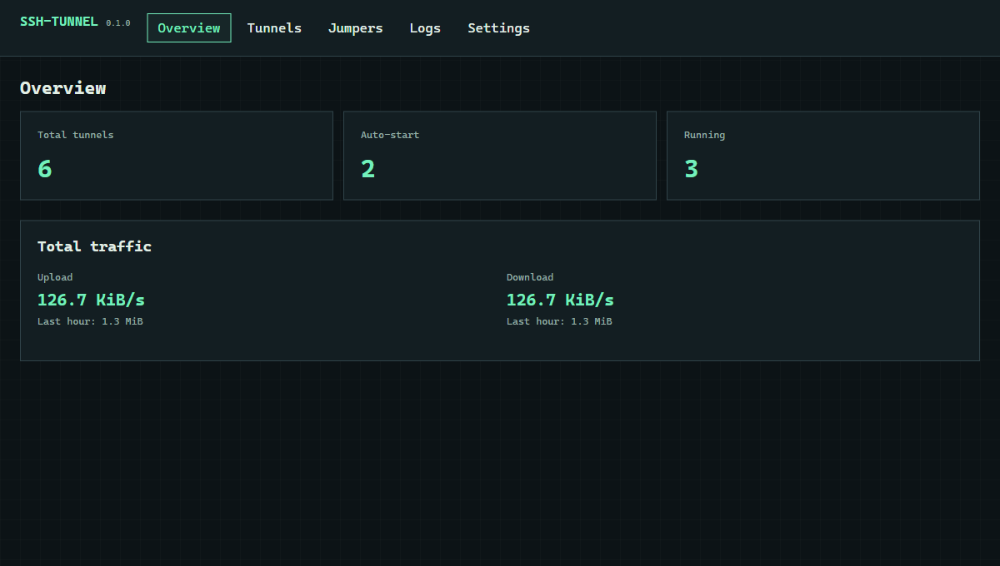
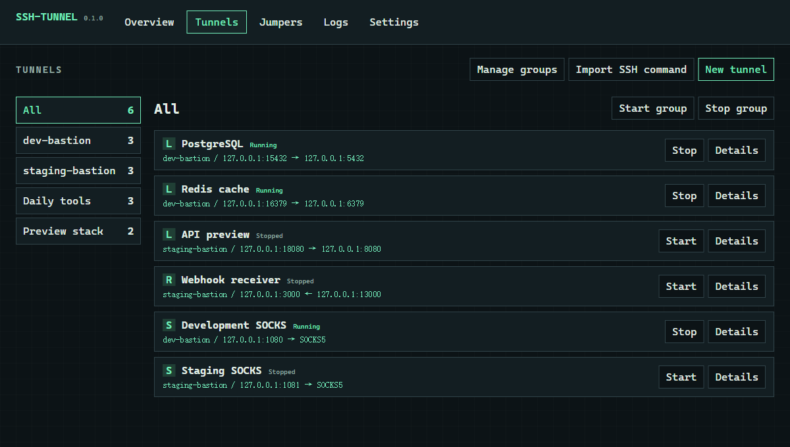

# ssh-tunnel

[English](README.md)

基于 **Tauri 2 + React + TypeScript + Rust** 的桌面 SSH 隧道管理工具。
版本：**0.1.2**。

## 界面预览

以下截图使用英文界面和隔离的示例配置。名称均为虚构；运行中的隧道与流量来自本机回环测试服务，不涉及真实服务器或个人数据。

### 概览

集中查看隧道数量、实时传输速率与近一小时流量。



### 隧道

展示本地、远程与 SOCKS5 转发，以及跳板机筛选、自定义分组和整组启停。



## 功能

- L 本地转发、R 远程转发、S SOCKS5 动态代理，支持有序的多跳板机链。
- 密码、普通或加密私钥、SSH Agent 认证；首次信任与主机密钥变更确认，不改写系统 `known_hosts`。
- 可配置重连间隔和次数，支持无限重试、固定间隔和指数退避；停止会取消待执行的重连。
- 全部、默认跳板机和自定义分组筛选，支持重叠成员、组排序及整组一键启停。
- 隧道条目右侧提供启停、连接测试与诊断、编辑、复制、删除和详情图标，悬浮可查看说明，并可直接切换自动启动；复制隧道保留原名。
- 勾选隧道可批量克隆或删除，也可从分组标题克隆整组。克隆时选择目标跳板机，新隧道归入它的默认分组，保留原名、后续跳板链和端口映射。新隧道保持停止并关闭自动启动，避免监听端口冲突。
- 删除跳板机前会列出首跳或后续跳引用它的隧道，确认后一起删除。
- 详情与概览显示实时速率、近 1 小时流量；按秒滚动统计，空闲时也会过期，隧道重启不清零。
  历史仅保存在内存，退出应用或替换配置后清零。
- 连接测试、SSH 延迟测量、本地故障诊断；审核后导入 SSH 配置或命令。
- 配置导入导出、配置目录切换、托盘、开机启动、明暗像素风主题；仅简体中文和英文。

## 命令行

`ssh-tunnel.exe` 打开图形界面，`ssh-tunnel-cli.exe` 在控制台运行，两个文件放在同一目录。两者均支持 `--version`，原有 `ssh-tunnel.exe cli …` 调用继续可用。Agent 可运行 `agent-help` 查看使用指引。操作命令将 JSON 写入标准输出，将 Agent 提示写入标准错误；在命令前加 `--no-hints` 可关闭提示。

同一 Windows 用户使用相同配置入口时，桌面和命令行连接同一个后台进程。可以先运行命令行，再打开桌面接管已经运行的隧道。单次命令结束后隧道继续运行，桌面「退出应用」或 `ssh-tunnel-cli shutdown` 会停止该配置的隧道并退出后台。指定配置时，两个入口使用相同的 `--config` 绝对路径。设置了 `SSH_TUNNEL_CONFIG` 时优先使用它。

```powershell
.\ssh-tunnel-cli.exe agent-help
.\ssh-tunnel-cli.exe --help
.\ssh-tunnel-cli.exe help clone_group
.\ssh-tunnel-cli.exe list | ConvertFrom-Json
.\ssh-tunnel-cli.exe start 1
.\ssh-tunnel-cli.exe status | ConvertFrom-Json
.\ssh-tunnel-cli.exe test 1 | ConvertFrom-Json
'{"request":{"tunnel_ids":[1,2],"target_jumper_id":3}}' | .\ssh-tunnel-cli.exe clone_group -
```

示例中的 ID 请从 `list` 获取。`start` 提交启动请求，通过 `list` 查看最终状态；首次连接可用 `get_pending_trust` 查看指纹，独立核对后再用 `resolve_host_key` 确认。对已停止的隧道运行 `test` 可得到各阶段检查结果。命令返回 JSON，退出码 0 表示成功，1 表示操作失败，2 表示命令或输入格式错误，3 表示连接测试发现问题或需要确认密钥。程序可将 UTF-8 JSON 从标准输入传给 `-`，避免将口令放入命令历史。`list` 隐去跳板机密码，`export_config` 导出的完整配置含明文凭据。

## 环境要求

- Node.js 24、pnpm 10、稳定版 Rust；Windows 使用 MSVC 工具链。
- Windows：Visual Studio Build Tools 的 C++ 桌面开发组件、Windows SDK、WebView2 Runtime。
- macOS：Xcode 命令行工具。

tag 发布工作流包含 Windows/macOS/Linux 构建与测试。Windows 原生回归使用实际 WebView2 应用；
macOS/Linux 桌面交互，以及系统托盘、选择器、剪贴板交互，尚未被自动化测试完整覆盖。

## 开发运行

```powershell
pnpm --dir frontend install --frozen-lockfile
pnpm dev
```

已打开的 Windows 终端若找不到 `cargo`，先刷新当前进程的路径：

```powershell
$env:Path = "$env:USERPROFILE\.cargo\bin;$env:Path"
cargo --version
```

`pnpm dev` 启动真实桌面窗口并支持前端热更新。单独运行 Vite
（`pnpm --dir frontend dev`）没有原生 SSH、文件和配置接口，不是独立网页版本。
构建和运行独立 Debug EXE：

```powershell
pnpm build --debug --no-bundle
.\target\debug\ssh-tunnel.exe
```

## 测试验证

```powershell
cargo fmt --all --check
cargo test --workspace --locked
cargo clippy --workspace --all-targets --locked -- -D warnings
pnpm test:frontend
node --test scripts/native-ci-profile.test.mjs
pnpm build:release
pnpm test:native:release
pnpm test:native:config
```

Windows 原生测试使用本机回环 SSH 服务、虚拟凭据、隔离配置及 WebView 目录，
开机启动条目限定为 `ssh-tunnel-test-*`，不会连接真实服务器。
`test:native:config` 使用模拟主目录验证默认路径查找和原始配置字节备份。
证据保存在 `target/native-smoke/`，每次记录受测 EXE 的 SHA-256。

## Windows 发行构建

两个正式 EXE 均位于 `target/release/`。构建、测试通过并提交代码、工作区干净后执行：

```powershell
pnpm stage:windows
```

EXE、`SHA256SUMS` 和 `build-info.json` 保存到 `build/bin/0.1.2/`；
同版本已有不同文件时不会覆盖。EXE 依赖 WebView2，并非已签名的安装包。

## Tag 发布

仅推送稳定版本 tag（例如 `v0.1.2`）会触发发布工作流，普通代码推送和 PR 不会触发。
全部平台构建、测试通过后，统一发布 Windows EXE/NSIS、macOS Universal DMG、
Linux AppImage/DEB，以及校验和和源码提交清单。

Windows 未进行商业代码签名；macOS 仅临时签名，未经过 Apple 公证，系统可能警告或阻止运行。
版本校验、各平台本机构建指令、tag 冲突及发布保护见 [RELEASING.md](RELEASING.md)。

## 配置与安全

- 正式版：Windows 使用 `%USERPROFILE%\.ssh-tunnel\config.toml`，macOS 使用 `~/.ssh-tunnel/config.toml`。
- Debug 保持现有的 `~/.ssh-tunnel-migration/config.toml` 路径，以保留开发设置，并与正式数据隔离。
- `SSH_TUNNEL_CONFIG` 或 `--config <绝对文件路径>` 可指定其他入口，环境变量优先。
  入口旁的 `config.root` 可重定向到绝对配置目录；设置页显示实际位置。
- 读取不会改写配置；保存会保留唯一命名的原始字节备份。目录切换实时生效并保留源文件。
- 配置及导出文件含有**明文凭据和主机信任记录**，请保护文件权限，仅导入可信文件。
- 信任密钥前请独立核对指纹；已撤销的密钥会被拒绝。导入的 SSH 命令只解析，不执行。
- `ui.locale` 随配置目录保存；主题与默认分组可见性保存在 WebView 存储中。
  全局日志最多保留 500 条内存事件。
- 正式版开机启动名称为 `ssh-tunnel`，Debug 为 `ssh-tunnel-migration`。
  Windows 保存失败时会恢复原来的启动命令。
- 测试可通过 `SSH_TUNNEL_AUTOSTART_NAME=ssh-tunnel-test-...` 指定隔离启动条目，
  通过 `SSH_TUNNEL_KNOWN_HOSTS` 的绝对路径指定测试用主机密钥文件。

## 工程结构

- `frontend/`：React 界面、组件测试、原生 WebView 回归脚本。
- `crates/tunnel-core/`：SSH、转发、运行时、配置和集成测试。
- `src-tauri/`：原生命令、桌面生命周期、系统对话框和启动注册。
- `scripts/`：Windows 环境及 CI 工具、发行文件整理。
- `build/`：应用图标与不纳入版本管理的本地发行产物。

许可见 [LICENSE](LICENSE)。
