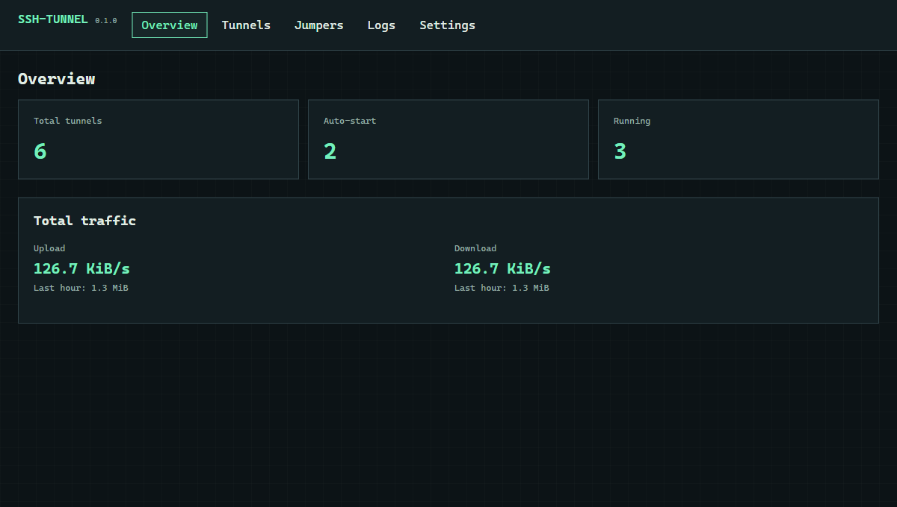
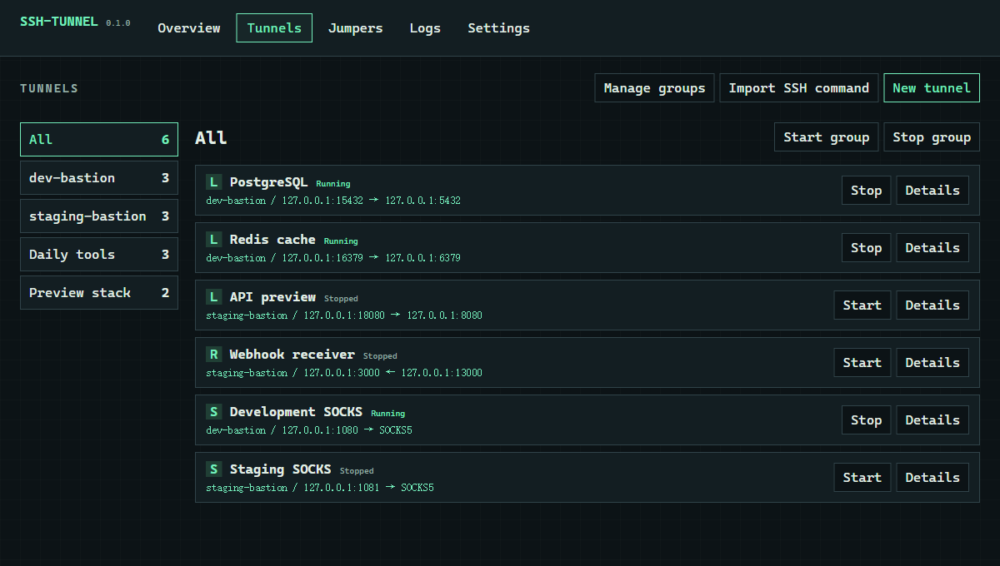

# ssh-tunnel

[简体中文](README.CN.md)

A desktop SSH tunnel manager built with **Tauri 2 + React + TypeScript + Rust**.
Version: **0.1.2**.

## Screenshots

English UI with isolated example configurations. All names are fictional; running
tunnels and traffic use local loopback test services, not real servers or personal data.

### Overview

Tunnel counts, live transfer rates and rolling last-hour traffic at a glance.



### Tunnels

Local, remote and SOCKS5 forwarding with jumper filters, custom groups and group controls.



## Features

- Local (L), remote (R) and dynamic SOCKS5 (S) forwarding through ordered jumper chains.
- Password, private/encrypted key and SSH-agent authentication; explicit first-trust
  and changed-host-key confirmation without rewriting system `known_hosts`.
- Configurable reconnect intervals and retry limits, including unlimited retries,
  fixed intervals and exponential backoff. Stop cancels pending reconnects.
- All/default-jumper/custom group filters, overlapping membership, group ordering
  and one-click group start/stop.
- Tunnel rows expose start/stop, connection diagnostics, edit, duplicate, delete and details
  as icons with hover labels, plus an auto-start switch. Duplicates keep the original name.
- Select individual tunnels for batch deletion or cloning, or clone an entire group from its header. Clones appear in the target jumper’s default group.
  Only the first hop changes; subsequent hops and port mappings are preserved.
  Clones are stopped with auto-start off to avoid competing listeners.
- Deleting a jumper previews all dependent tunnels, including later-hop references, for confirmation.
- Live rates and rolling last-hour traffic volumes in details and the overview.
  History uses one-second buckets, survives tunnel restarts and expires while idle.
  It is in-memory and resets on application exit or configuration replacement.
- Connection testing, SSH latency measurement and local diagnostic recommendations.
- Reviewed SSH config/command imports, configuration export and directory relocation.
- Tray behavior, login startup, light/dark pixel-style UI, Simplified Chinese and English.

## Command line

Keep `ssh-tunnel.exe` (GUI) and `ssh-tunnel-cli.exe` (console) together. Run `ssh-tunnel-cli --help` for the catalog, `help COMMAND` for arguments, and `agent-help` for automation. Operational commands send JSON to stdout and agent hints to stderr. Place `--no-hints` before the command to suppress hints. Both executables support `--version`. Existing `ssh-tunnel.exe cli …` calls still work. Both entry points attach to the background controller for the same user and configuration anchor. CLI commands work before the GUI opens. Closing a client command leaves listeners running. Use `ssh-tunnel-cli shutdown` or Quit application to stop them. Supply the same absolute `--config` to both entry points when working with a custom configuration. `SSH_TUNNEL_CONFIG` takes precedence.

```powershell
.\ssh-tunnel-cli.exe agent-help
.\ssh-tunnel-cli.exe list | ConvertFrom-Json
.\ssh-tunnel-cli.exe start 1
.\ssh-tunnel-cli.exe status | ConvertFrom-Json
'{"request":{"tunnel_ids":[1,2],"target_jumper_id":3}}' | .\ssh-tunnel-cli.exe clone_group -
```

Use IDs from `list`. `start` requests startup. Poll `list` and check `get_pending_trust` for a host-key challenge. Verify the fingerprint before calling `resolve_host_key`. `test ID` diagnoses a stopped tunnel. Stdout contains JSON, errors go to stderr. Exit codes are 0 for success, 1 for operation failure, 2 for usage/JSON errors, and 3 for a negative test report or pending probe challenge. Pass UTF-8 JSON on stdin (`-`) for credentials. `list` omits passwords. An explicit configuration export contains plaintext credentials.

## Requirements

- Node.js 24, pnpm 10, stable Rust with the MSVC toolchain on Windows.
- Windows: Visual Studio Build Tools with Desktop development with C++, Windows SDK,
  and Microsoft Edge WebView2 Runtime.
- macOS: Xcode command-line tools.

The tag-triggered release workflow builds/tests Windows, macOS and Linux. Windows native regression uses the
real WebView2 application. macOS/Linux desktop interaction and system tray/picker/clipboard
interactions are not fully covered by these automated tests.

## Development

```powershell
pnpm --dir frontend install --frozen-lockfile
pnpm dev
```

If an already-open Windows terminal cannot find `cargo`, refresh its environment:

```powershell
$env:Path = "$env:USERPROFILE\.cargo\bin;$env:Path"
cargo --version
```

`pnpm dev` launches the desktop window with live frontend updates. Running Vite alone
(`pnpm --dir frontend dev`) does not provide native SSH/filesystem/configuration IPC.
To build and run a standalone debug executable:

```powershell
pnpm build --debug --no-bundle
.\target\debug\ssh-tunnel.exe
```

## Verification

```powershell
cargo fmt --all --check
cargo test --workspace --locked
cargo clippy --workspace --all-targets --locked -- -D warnings
pnpm test:frontend
node --test scripts/native-ci-profile.test.mjs
pnpm build:release
pnpm test:native:release
pnpm test:native:config
```

The Windows native tests use loopback SSH fixtures, synthetic credentials, isolated
configuration/WebView directories and reserved `ssh-tunnel-test-*` startup entries.
They never connect to user servers. `test:native:config` checks default-path lookup
and exact-byte configuration backups in a synthetic home. Evidence is kept under
`target/native-smoke/`; each run records the tested binary's SHA-256.

## Windows Release

The release build produces both executables in `target/release/`. After building/testing
from a clean committed tree, run:

```powershell
pnpm stage:windows
```

This preserves both executables in `build/bin/0.1.2/`, with `SHA256SUMS` and `build-info.json`.
It refuses to overwrite different bytes already staged for that version. The EXE
requires WebView2 and is not a signed installer.

## Tagged Releases

Only pushing a stable version tag (for example `v0.1.2`) triggers the release workflow.
Ordinary code pushes and pull requests do not start it. All platform builds/tests must
pass before Windows EXE/NSIS, macOS Universal DMG and Linux AppImage/DEB packages are
uploaded and published together with checksums and source manifests.

Windows packages are unsigned; macOS packages have an ad-hoc signature and are not
Apple-notarized. OS security warnings may occur. See [RELEASING.md](RELEASING.md) for
version validation, native build commands, tag conflicts and publication safeguards.

## Configuration and Security

- Release configuration: `%USERPROFILE%\.ssh-tunnel\config.toml` on Windows,
  `~/.ssh-tunnel/config.toml` on macOS.
- Debug configuration keeps the existing `~/.ssh-tunnel-migration/config.toml` path
  to preserve development settings. It is separate from production data.
- `SSH_TUNNEL_CONFIG` or `--config <absolute-file>` selects another anchor; the
  environment variable takes precedence. `config.root` beside the anchor can redirect
  to an absolute configuration directory. Settings shows the effective location.
- Reading configuration does not rewrite it; saves preserve unique original-byte
  backups. Directory changes take effect live, retaining source files.
- Configurations and exports contain **plaintext credentials and host trust records**.
  Protect their filesystem permissions and import only trusted files.
- Verify host fingerprints independently before approval. Revoked keys are rejected.
  Imported SSH commands are parsed, never executed.
- `ui.locale` follows the configuration directory; theme and default-group visibility
  are stored in WebView storage. Global logs keep up to 500 events in memory.
- Login startup uses `ssh-tunnel` for release and `ssh-tunnel-migration` for debug.
  Windows save failures restore the previous startup command.
- Tests may override startup using `SSH_TUNNEL_AUTOSTART_NAME=ssh-tunnel-test-...` and
  known-hosts using an absolute `SSH_TUNNEL_KNOWN_HOSTS` path.

## Source Layout

- `frontend/`: React UI, component tests and native WebView smoke harness.
- `crates/tunnel-core/`: SSH, forwarding, runtime, configuration and integration tests.
- `src-tauri/`: native commands, desktop lifecycle, dialogs and startup registration.
- `scripts/`: Windows environment/CI support and release staging.
- `build/`: application icons and ignored local release output.

See [LICENSE](LICENSE).
